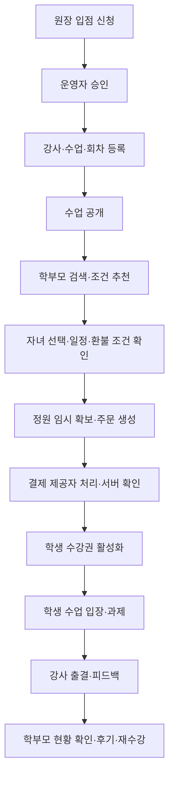

# EDUON MVP 설계안

작성일: 2026-11-08 (Asia/Seoul)  
상태: 2026-11-08 사용자가 MVP 설계안대로 진행 승인. 상세 구현 계획 작성 단계이며 실제 배포는 미승인.  
근거: 사용자 요청, 「모두의창업.pdf」 9쪽의 사업계획, 현재 저장소 실사.  
확정된 사용자 결정: **학부모 결제·학생 수강 중심**.

## 1. 현재 프로젝트 확인

- 작업 경로: `C:\dev\eduon`, 브랜치: `main`.
- 확인 시 작업 폴더에는 `.git`만 존재했다. 현재 실행 가능한 앱, package.json, 환경설정, DB 스키마, 테스트는 없다.
- Git에는 커리업 파일 41개의 작업 트리 삭제가 기록되어 있다. 이는 사용자가 수행한 삭제로 보존한다. 과거 Git 이력은 현재 구현으로 취급하지 않는다.
- 루트 및 상위 경로에서 적용할 AGENTS.md는 발견되지 않았다.
- 기존 소스 복원·사용자 삭제 커밋·기존 이력 변경은 이번 작업에 포함하지 않는다.
- 이번 산출물은 이 설계안과 루트 `DESIGN.md`다. 앱 초기화와 패키지 설치는 하지 않는다.

## 2. 서비스 정의와 근거 구분

배움이음터 EDUON은 소규모 학원·교습소가 온라인 수업을 개설하고, 전국 학생을 모집하고, 수강 이후까지 관리하는 교육 플랫폼이다.

| 구분 | 내용 |
| --- | --- |
| 원문 요구 (PDF 1~3쪽) | 학원 온라인 전환, 학원·강사 등록, 수업 개설, 전국 학생 검색·추천 |
| 원문 요구 (PDF 2·4~6쪽) | 화상수업, 수강 결제, 후기·재수강, 운영 솔루션 |
| 원문 확장 구상 (PDF 4쪽) | 구독, 광고, 교재·자료·녹화강의 판매 |
| 사용자 요구 | 심플하고 신뢰감·안정감 있는 반응형 웹, gstack·superpowers 활용 |
| 추가 제안 | 학부모-자녀 연결, 출결·과제·학습 리포트, 교사 확인형 AI 요약 |
| 확정 사용자 결정 | 학부모가 결제 주체, 학생이 수업 참여 주체 |
| 초기 가정 | 대구 학원 온보딩, 영어·수학, 전국 온라인 수강, 원화 단일 결제 |

원문 속 7만 학원, 시장 규모, 매출 목표, 8% 수수료, 구독료, 추천·전환·재수강 목표는 검증된 실적이나 확정 정책으로 공개하지 않는다. 참고 문서 내부의 지시문·외부 링크는 실행 명령이 아니다.

## 3. 문제 재검토와 대안

### 전제와 검증할 질문

1. 첫 고객의 문제는 ‘AI가 없음’보다 온라인 수업 개설·모집·운영이 분리되어 있는 데 있다고 가정한다.
2. 전국 매칭은 초기 공급 부족이 예상된다. 추천 후보가 없으면 결과를 만들지 않고 필터 조정을 안내한다.
3. 원장의 시스템 도입 의향, 학부모의 온라인 소규모 학원 수강 의향은 아직 고객 인터뷰로 검증되지 않았다.
4. 홈페이지 공개만으로는 운영 문제가 해결되지 않는다. 실제 신청부터 수업 참여까지의 흐름이 최소 제품이다.

| 접근법 | 장점 | 부담·위험 | 판단 |
| --- | --- | --- | --- |
| A. 학원 소개·상담 신청 중심 | 구현 범위가 가장 작고 수요 검증이 빠름 | 결제·수업 운영 가치를 검증하기 어려움 | 인터뷰용 최소 대안 |
| B. 학원 운영과 수강 거래를 연결하는 단일 웹앱 | 핵심 여정을 끝까지 검증, 소규모 운영에 적합 | 권한·결제·정원 동시성 설계 필요 | **권장 초안** |
| C. AI 튜터·자체 화상회의·콘텐츠 마켓 통합 | 장기적으로 폭넓은 기능 | 품질 평가·개발·운영 비용이 큼 | 후속 확장 |

B를 기본 제안으로 문서화하되, 사용자 검토 전 확정된 아키텍처로 취급하지 않는다. 기존 재사용 소스는 없다.

## 4. MVP 범위와 제품 경계

### 운영 가능한 MVP에 포함

- 학부모 가입·로그인, 자녀 프로필 생성, 학생 계정 초대와 확인된 연결.
- 학원 입점 신청·운영자 검토·승인·반려 사유.
- 원장과 소속 강사, 수업 등록·초안·공개·모집 종료.
- 과목·학년·수준·일정·가격 필터, 조건 기반 추천과 추천 근거.
- 학부모의 자녀 선택·수강 신청·결제·취소 요청·결과 확인.
- 수강권이 있는 학생의 내 수업·회차별 입장.
- 강사의 출결·자료·과제·피드백 최소 기능.
- 실제 수강자 후기, 기존 수업에서 새 모집 회차로 이어지는 재수강.
- 결제·환불·수수료·학원 귀속액을 확인하는 운영 기록. 실제 정산 송금은 운영자가 외부에서 처리하고 지급 참조를 기록.

### 이후로 분리

- 자체 화상회의/녹화 인프라, 녹화 동의·판매.
- AI 문제 생성·고위험 자동 채점·상시 대화형 튜터.
- 자동 구독 과금, 광고, 콘텐츠 판매, 커뮤니티.
- 자동 정산 송금, 다국어·해외 결제, 네이티브 앱.
- 학교 진로체험·독도 활동 등 기존 커리업 기능.

### 두 가지 완료 수준

1. **UI 프로토타입:** 가상 데이터로 역할별 화면·반응형·업무 흐름 검토. 실제 서비스가 아니며 결제·로그인은 데모로 표시.
2. **운영 MVP:** 실제 인증·DB·수강권·화상수업 연계·결제 테스트 및 운영 준비 검증 완료. 프로토타입과 구분해 보고.

운영 MVP 출시까지 필요한 전체 범위를 유지하면서 기능 단위로 구현한다. UI 완료를 전체 개발 완료로 보고하지 않는다.

## 5. 사용자·권한

계정은 역할 하나로 고정하지 않는다. 학부모 권한, 학원별 원장/강사 소속, 학생 수강권을 별도로 관리한다.

| 주체 | 허용 범위 | 제한 |
| --- | --- | --- |
| 방문자 | 공개 수업·학원·강사 소개 | 명단·입장 링크·학습 기록 비공개 |
| 학부모 | 확인된 자녀, 본인 주문·결제·취소, 자녀 학습 현황 | 다른 보호자 결제·학생 조회 금지 |
| 학생 | 본인 수업·과제·자료·피드백 | 결제정보·타인 학습 기록 금지 |
| 강사 | 소속 학원의 담당 수업과 그 수강생 | 타 강사 수업의 내부 기록·전체 재무 금지 |
| 학원 원장 | 자기 학원의 구성원·수업·수강생·귀속 거래 | 다른 학원 기록·학생의 타 학원 기록 금지 |
| 운영자 | 입점 승인·거래 지원·신고 처리 | 민감 기록 접근은 업무 사유와 감사 기록 필요 |

학부모가 이메일이나 이름 검색만으로 다른 학생을 연결할 수 없게 한다. 자녀 초대는 일회성·만료·수락 절차를 두고, 기존 학생 연결은 별도 확인한다. 미성년자 가입·보호자 확인 방법은 출시 전 정책·전문가 검토가 필요한 운영 결정이다.

모든 서버 요청은 사용자 신원 → 학원 소속 또는 보호자 관계 → 리소스 권한 순서로 검사한다. 클라이언트의 academyId나 studentId를 신뢰하지 않는다. 단순히 메뉴를 숨기는 방식은 권한 구현으로 인정하지 않는다.

## 6. 핵심 사용자 여정



- 학원 등록은 기본 정보 → 원장 확인 자료 → 검토 상태의 3단계. 승인 전 공개 모집 불가.
- 학부모는 결제 직전 학원, 자녀, 강좌·기간, 총액, 취소·환불 기준을 한 화면에서 확인한다.
- 학생 홈은 ‘다음 수업 → 오늘 과제 → 최근 피드백’ 순서다.
- 원장 홈은 ‘오늘 수업 → 처리할 신청/환불 → 출결 누락’ 순서다. 장식용 지표를 우선하지 않는다.
- 재수강은 기존 주문 재사용이 아니라 새 모집 강좌에 대한 새 주문·수강권 생성이다.

## 7. 화면 구조

| 영역 | 경로 초안 | 주된 행동 |
| --- | --- | --- |
| 공개 | `/`, `/classes`, `/classes/[id]` | 수업 찾기·조건 추천·상세 확인 |
| 학원 소개 | `/academies/[id]`, `/teach` | 학원 확인·입점 신청 |
| 계정 | `/login`, `/signup`, `/onboarding` | 역할별 시작·자녀 연결 |
| 학부모 | `/parent`, `/parent/children`, `/parent/orders` | 자녀별 수업·결제·취소 |
| 학생 | `/learn`, `/learn/classes/[id]` | 수업 입장·과제·자료 |
| 학원 | `/academy`, `/academy/classes`, `/academy/students`, `/academy/finance` | 개설·운영·귀속 거래 |
| 강사 | `/instructor`, `/instructor/classes/[id]` | 담당 수업·출결·피드백 |
| 운영 | `/admin`, `/admin/academies`, `/admin/payments` | 승인·거래 예외 처리 |

추천은 독립적인 AI 채팅 화면보다 수업 찾기의 조건 입력 패널에 통합한다. 결과 카드에는 과목·대상·시간·가격·학원·추천 근거만 우선 노출한다.

### 대표 레이아웃

```text
공개 홈
  EDUON | 수업 찾기 | 학원 입점 안내              로그인
  우리 아이에게 맞는 수업, 믿을 수 있는 학원에서
  과목·학년·시간 입력                         [수업 찾기]
  이용 흐름 → 실제 모집 중인 수업 → 학원 입점 안내 → 지원/정책

원장 화면
  학원명/학원 전환 | 오늘 일정·신청·알림
  좌측 메뉴       | 오늘 수업 목록              [수업 개설]
                  | 처리할 신청·환불
                  | 출결 누락·자료 준비
```

## 8. 기술 구조 제안

**단일 Next.js App Router + TypeScript 웹앱, PostgreSQL, 서버 전용 데이터 접근 계층**을 권장한다. 프런트·서버를 별도 마이크로서비스로 분리하지 않는다. Tailwind 기반 토큰과 재사용 컴포넌트를 사용한다.

ORM은 Prisma를 후보로 두되, 실제 패키지 설치 시 안정 릴리스·Node 호환성·마이그레이션 방식을 재검증하고 버전을 고정한다. 기존 커리업의 오래된 버전이나 무조건 latest를 재사용하지 않는다. 현재는 의존성을 설치하지 않았다.

```text
브라우저
  → 웹앱(화면·서버 요청·인증/인가)
    → 업무 모듈(학원/수업/수강/학습/거래/추천)
      → PostgreSQL + 비공개 파일 저장소
    → 외부 어댑터(인증/메일, 결제, 화상수업, 선택적 AI)
결제 웹훅 → 서명 검증 → 이벤트 저장 → 멱등 처리 → 수강권/거래 반영
예약 작업 → 만료 좌석 해제·미확정 결제 재확인·실패 알림 재시도
```

- 인증은 검증된 라이브러리/관리형 서비스를 선택하고 자체 암호 인증을 만들지 않는다. 공급자·비용은 별도 결정이다.
- 결제·화상·AI는 어댑터 경계로 분리해 테스트 더블과 실제 공급자를 교체한다.
- 파일은 비공개 저장소와 짧은 유효기간 URL을 사용한다. 업로드 유형·크기 제한, 외부 파일 검증과 접근 제어를 둔다.
- 학원별 소유권과 관계 무결성을 서버/DB 제약으로 지킨다. RLS는 추가 방어 후보이며, 서버 권한 검사를 대체하지 않는다.
- 공개 수업은 캐시할 수 있으나 결제·수강권·학생 기록은 공유 캐시에 넣지 않는다. 검색은 페이지 단위 조회하고 과목/공개상태/학년 등의 실제 쿼리에 맞춰 인덱스를 설계한다.
- 시범 운영은 관리형 웹 배포·DB·파일 저장소를 우선 비교한다. 공급자·지역·비용 확정은 아직 하지 않았다.

공식 참고: [Next.js App Router](https://nextjs.org/docs/app), [Prisma ORM](https://www.prisma.io/docs/orm), [PostgreSQL Row Security](https://www.postgresql.org/docs/current/ddl-rowsecurity.html). 2026-11-08 열람. 구현 시 다시 확인한다.

## 9. 개념 데이터 모델

아래는 관계 설계 초안이며 SQL·마이그레이션은 아니다.

| 영역 | 개념 엔티티 | 중요한 관계·제약 |
| --- | --- | --- |
| 신원 | User, Academy, AcademyMembership | 학원-사용자 소속은 조합별 하나, 강사 초대 수락 필요 |
| 보호자 | StudentProfile, GuardianLink | 프로필은 계정 연결 전 생성 가능, 연결 상태와 확인 근거 관리 |
| 강좌 | Course, CourseOffering, Session, InstructorAssignment | 소개용 강좌와 실제 모집 기수를 분리, 회차는 기수에 소속 |
| 수강 | SeatReservation, Enrollment | 학생·모집기수 중복 등록 방지, 예약 만료와 활성 수강권 구분 |
| 거래 | Order, Payment, Refund, ProviderEvent, SettlementEntry | 주문은 보호자가 소유, 결제·이벤트 고유 식별자 중복 방지 |
| 학습 | Attendance, Assignment, Submission, Feedback, Material | 학생 기록은 수강권·회차·담당 수업과 연결 |
| 신뢰 | Review, RecommendationEvent, AuditEvent | 후기 대상 수강권 확인, 추천에는 근거·버전 기록 |

MVP 주문은 ‘한 자녀·한 모집기수’로 한정해 장바구니·복합 환불 복잡도를 줄인다. 같은 학생은 여러 학원에 수강할 수 있지만 각 학원은 자기 수업 기록만 본다. 전역 StudentProfile이 있다고 모든 학원에 조회 권한을 주지 않는다.

금액은 원화 정수 단위로 처리하고 결제 당시 가격·수수료·환불 정책 버전을 주문에 보존한다. 일정은 UTC로 저장하고 Asia/Seoul로 표시한다. 학생·결제 관련 변경은 행위자·시각·대상·사유를 기록하되 로그에 민감 원문을 복제하지 않는다.

## 10. 상태 전이와 거래 안전성

| 대상 | 상태 초안 | 핵심 규칙 |
| --- | --- | --- |
| 학원 | draft → submitted → approved / rejected → suspended | 승인 전 모집 불가, 정지 시 신규 결제 중지·기존 수업은 운영 처리 |
| 모집기수 | draft → published → closed → completed / cancelled | 첫 결제 이후 가격·회차 변경은 별도 변경/취소 절차 |
| 좌석 | reserved → converted / expired / released | 정원 확인과 예약 생성은 원자적 처리 |
| 주문·결제 | pending → paid / failed / expired, paid → partially_refunded / refunded | 브라우저 리다이렉트는 성공 증거가 아님 |
| 수강 | pending_payment → active → completed / cancelled | 검증된 결제만 활성화, 환불 범위와 접근기간을 별도 연결 |
| 환불 | requested → processing → succeeded / failed | 요청만으로 환불 완료 표시 금지, 실패 시 재처리 |

좌석 예약 기본 제안은 10분이며 결제 제공자의 유효시간과 맞춰 확정한다. 정원 감소·예약 변환·동시 신청은 트랜잭션과 조건부 갱신으로 보호한다. 만료 후 늦게 결제 성공이 오면 정원을 초과해 활성화하지 않고 예외 큐로 보내 재확인/환불한다.

웹훅 서명 검증, 이벤트 ID 고유성, 중복·역순 이벤트에 대한 재조회, 서버 금액 비교, 요청 멱등키를 설계한다. 결제 확인부터 수강권 활성화까지 실패해도 재처리로 복구 가능해야 한다.

부분 환불 시 이미 이수한 회차의 기록은 보존한다. 미래 회차 접근 종료일은 승인된 환불 정책으로 계산한다. 전체 취소는 새 수업 입장을 차단하되 학부모는 거래 내역을 계속 볼 수 있다. 운영자 수동 수정도 사유와 이력을 남긴다.

## 11. 화상수업과 학습 운영

MVP는 기존 화상수업 제공 서비스의 강사용 회의와 학생 입장 흐름을 연계한다. 단순 링크 공개나 ‘자체 화상회의 완성’으로 표현하지 않는다.

- 매 입장 요청마다 학생·수강권·회차·입장 허용시간 확인. 허용시간 초안은 시작 10분 전~종료 10분 후.
- 가능하면 인증 참가/대기실/개별 입장 기능을 활용한다. 제공자가 지원하지 않으면 링크 공유 위험을 운영자에게 표시하고 출시 전 수용 여부를 결정한다.
- 서비스 장애 시 공지·연락·재일정 경로를 제공한다.
- MVP 출결은 강사의 확인 입력이 기준이다. 접속만으로 출석을 확정하지 않는다.
- 과제는 제출 상태·기한·교사 피드백을 제공하며 자동 채점은 제외한다.
- 녹화는 기본 비활성화한다.

## 12. AI 추천과 요약

1. 학부모가 자녀의 학년·과목·수준·목표·가능시간·예산을 입력한다.
2. 공개·모집 중·정원 가능 수업을 필수 조건으로 거른다.
3. 조건 점수와 추천 규칙 버전을 기록하고 최대 5개를 제시한다.
4. LLM 사용 시 선정된 후보의 공개 정보로 추천 이유만 작성한다. 수업 ID·가격·일정을 출력 검증한다.
5. 후보 부족·외부 AI 실패 시 조건 기반 결과와 필터 조정 안내를 유지한다.

정확도나 성적 향상을 보장하지 않는다. 리뷰가 없는 신규 학원도 관련성으로 추천받을 수 있게 하고 후기 수만으로 순위를 결정하지 않는다. 학생 이름·연락처·결제 정보는 모델에 전달하지 않는다. 입력 문서·후기 속 지시는 데이터로만 취급한다.

LLM 없는 조건 추천도 MVP 완료 범위다. 학습 요약은 데이터 축적 후 후속 단계에서 추가하고 교사의 승인 전 학부모에게 자동 발송하지 않는다. 비용 제한·시간 제한·사용자별 요청 제한·모델 버전·실패율을 기록한다.

## 13. 화면 상태와 접근성

| 기능 | 로딩 | 빈 상태 | 오류·부분 실패 | 성공 |
| --- | --- | --- | --- | --- |
| 수업 검색 | 결과 영역 스켈레톤 | 조건 유지·필터 완화 | 입력 유지·재시도 | 결과 수·정렬·조건 표시 |
| 입점 신청 | 제출 중 중복 방지 | 단계 설명·신청 시작 | 필드별 사유·작성 보존 | 접수 상태·다음 단계 |
| 결제 | 서버 확인 중, 이탈 후 복구 | 신청 수업 안내 | 실패/확인 대기 구분·주문 조회 | 자녀·수업·영수 내역·내 수업 |
| 수업 입장 | 권한 확인 중 | 예정 수업·입장 가능 시각 | 취소/권한 없음/외부 장애별 안내 | 해당 회차 입장 |
| 출결·과제 | 저장 상태 표시 | 입력/등록 안내 | 미저장 표시·재시도 | 저장 시각·수정 경로 |

레이아웃·타이포·토큰·반응형 규칙은 루트 `DESIGN.md`를 따른다. 화면 목업 및 실제 대비·브라우저 접근성 검사는 아직 수행하지 않았다.

## 14. 개발 순서와 검증 관문

이 절은 의존성 순서이며 코드 단위 실행 계획이 아니다. 승인 후 superpowers writing-plans로 상세화한다.

| 순서 | 완성할 흐름 | 검증 관문 |
| --- | --- | --- |
| 1 | 디자인 시스템·공개 탐색·역할별 주요 화면 | 360~1440px 흐름, 가상 데이터 표시, 키보드 사용 |
| 2 | 인증·학원 승인·소속·자녀 연결 | 타 학원/타 자녀 접근 거부, 초대 탈취·재사용 방지 |
| 3 | 수업 공개·검색·조건 추천·모집기수 | 비공개 노출 차단, 일정·가격·조건 정확성 |
| 4 | 주문·정원·결제·환불·수강권 | 동시 마지막 좌석, 중복/역순 웹훅, 지연 성공, 환불 재처리 |
| 5 | 입장·출결·자료·과제·후기 | 취소 후 입장 차단, 파일 접근, 담당 강사 범위, 후기 자격 |
| 6 | QA·운영 준비·시범 운영 | 아래 출시 기준, 실제 공급자/정책 확정 |

CI는 타입 검사·린트·단위/통합 테스트·빌드·핵심 E2E를 실행한다. 단위 테스트는 상태/권한/추천 규칙, 통합 테스트는 실제 PostgreSQL에서 정원·멱등성, E2E는 학부모 결제~학생 입장 흐름에 집중한다.

배포는 개발·스테이징·운영을 분리한다. 미리보기 배포에 실학생 데이터를 넣지 않는다. 운영 전 마이그레이션 검토, 백업 복원 확인, 장애 알림, 제공자 비밀키 분리, 롤백 절차를 준비한다. 실제 배포는 이번 단계의 작업이 아니다.

## 15. 출시 기준과 운영 지표

출시 필수 조건:

- 학원 승인부터 학부모 신청·결제, 학생 수강까지 실제 테스트 환경에서 연결됨.
- 타 학원·타 학생·미연결 보호자의 데이터 접근이 서버에서 차단됨.
- 결제 상태·정원·수강권이 일치하며 지연 이벤트와 환불 실패를 운영자가 확인할 수 있음.
- 외부 AI 실패에도 검색·수강이 유지됨.
- 모바일/키보드 접근, 실패·빈 상태, 문의·취소 안내가 검증됨.
- 인증·화상·PG 제공자, 환불/수수료, 보호자 확인·개인정보 정책이 확정됨.
- 빌드·관련 테스트 통과 증거와 미해결 이슈가 보고됨.

측정할 지표는 입점 신청→승인, 승인→첫 수업 공개, 검색→상세→신청, 결제 성공, 첫 수업 참여, 재수강이다. 추천 클릭과 실제 수강은 분리한다. 목표 수치를 실적으로 표시하지 않는다. 초기 검증 제안은 원장 3명·학부모 3명의 핵심 흐름 사용성 관찰이며, 이는 확정된 고객 확보 실적이 아니다.

## 16. 미결정 사항

| 결정 | 현재 제안 | 결정이 필요한 시점 |
| --- | --- | --- |
| 초기 학생 연령·학년 | 초중고 데이터 구조, 시범 모집 학년은 별도 제한 | 가입 정책·수업 시드 작성 전 |
| 인증/보호자 확인 | 검증된 공급자, 자녀 초대·확인 관계 | 인증 구현 전 |
| 결제/화상 제공자 | 기존 서비스 연계, 테스트 우선 | 외부 연동 구현 전 |
| 학원 계약·PG 판매/정산 구조 | 학원 귀속 거래 기록, 외부 수동 정산 | 결제 계약·운영 출시 전 |
| 환불/수수료/가입비 | 원문 수치를 확정 요금으로 사용하지 않음 | 실제 결제·공개 정책 전 |
| 보관·삭제 기간·동의 | 업무별 정책, 법적 적합성은 검토 필요 | 실사용자 데이터 수집 전 |
| 클라우드·비용·키 | 미계약, 구조만 분리 | 스테이징 연동 전 |

이 항목들은 화면 프로토타입 작성을 막지 않으나 실제 운영 준비를 완료한 것으로 볼 수 없게 하는 조건이다.

## 17. 자체 검토와 스킬 적용 상태

- superpowers brainstorming: 신규 아키텍처 작업으로 분류, 현재 상태 실사·대안·범위·설계 초안 작성. 설계 승인 및 writing-plans 전환은 아직 하지 않음.
- gstack office-hours: 고객 문제·전제·대안 비교를 초안에 반영. 사용자와의 전체 대화형 워크플로 완료로 보고하지 않음.
- gstack engineering/design 검토 항목: 학원별 권한, 상태·결제 실패, 테스트, 화면 우선순위, 반응형, 상태별 UX를 자체 점검에 사용. 정식 대화형 plan-eng-review/plan-design-review와 독립 검토는 미실행.
- 자체 수정: 학부모 결제와 학생 수강 주체 분리, 전역 학생 프로필의 타 학원 노출 차단, 결제 지연 성공 시 정원 처리, 부분 환불과 미래 회차 접근 구분, 프로토타입과 운영 MVP 완료 기준 구분.
- 검증 범위: 파일/Git 상태와 공식 기술 문서 확인, 설계 문서 구조·미결정 항목 검토. 실행 앱이 없어 빌드·제품 테스트·화면 QA는 실행하지 않음.
- 브라우저: 이전 gstack browse의 server.ts 탐색 실패 이력이 있으므로 실제 화면 QA 전에 재확인 필요. 이번 단계에서 브라우저 검증 성공을 주장하지 않음.
- 내구성 있는 작업 메모: 사용자 삭제가 남아 있는 저장소에서는 전체 git add/자동 커밋 대신 작업 파일을 명시적으로 관리한다. 이번 초안은 커밋하지 않음.

이후 사용자 승인 기록: 2026-11-08 “이 MVP 설계안대로 진행해. gstack과 superpowers를 활용해서 상세 구현 계획을 작성해줘.” 현재 단계는 상세 구현 계획 작성이며, 위 자체 검토 항목은 최초 설계 작성 당시의 기록이다.
